# Elektron Team | WRO Future Engineers 2026 European Open

## Introduction

We are Team Elektron from the High School of Electrical Engineering in Sarajevo, Bosnia and Herzegovina. This repository documents our autonomous vehicle for the WRO Future Engineers 2026 European Open in Zagreb.

The robot is a compact, fully custom platform with a 3D-printed chassis, custom four-layer PCB, Raspberry Pi 5, Raspberry Pi Pico 2 Zero, camera vision, Time-of-Flight sensing, an IMU, encoder feedback, and closed-loop motor control. It was designed for both the Open Challenge and the Obstacle Challenge.

## Sponsors

We thank our sponsors for supporting the development and manufacturing of the robot.

<table>
  <tr>
    <td align="center"></td>
    <td align="center"></td>
    <td align="center"><strong>Birisal D.O.O.</strong></td>
  </tr>
</table>

## Team photo

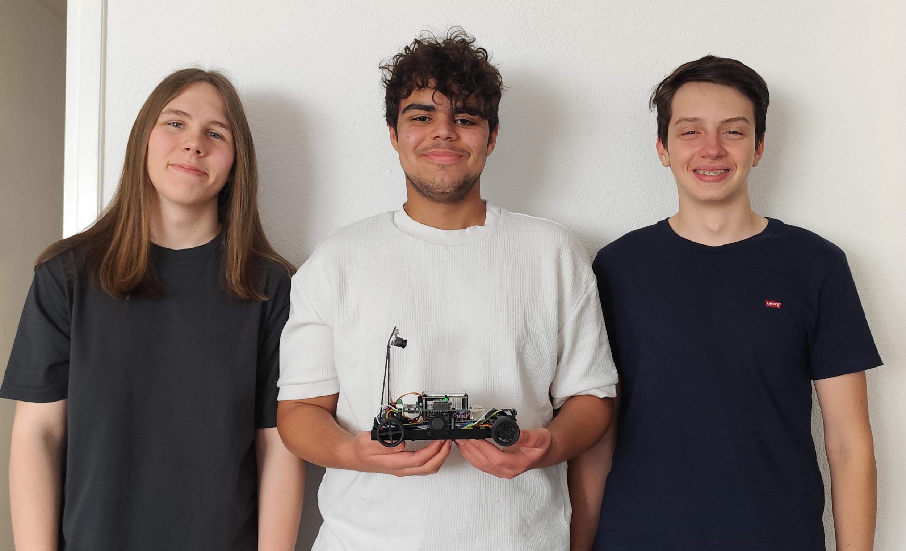

## Robot gallery

<table>
  <tr>
    <td>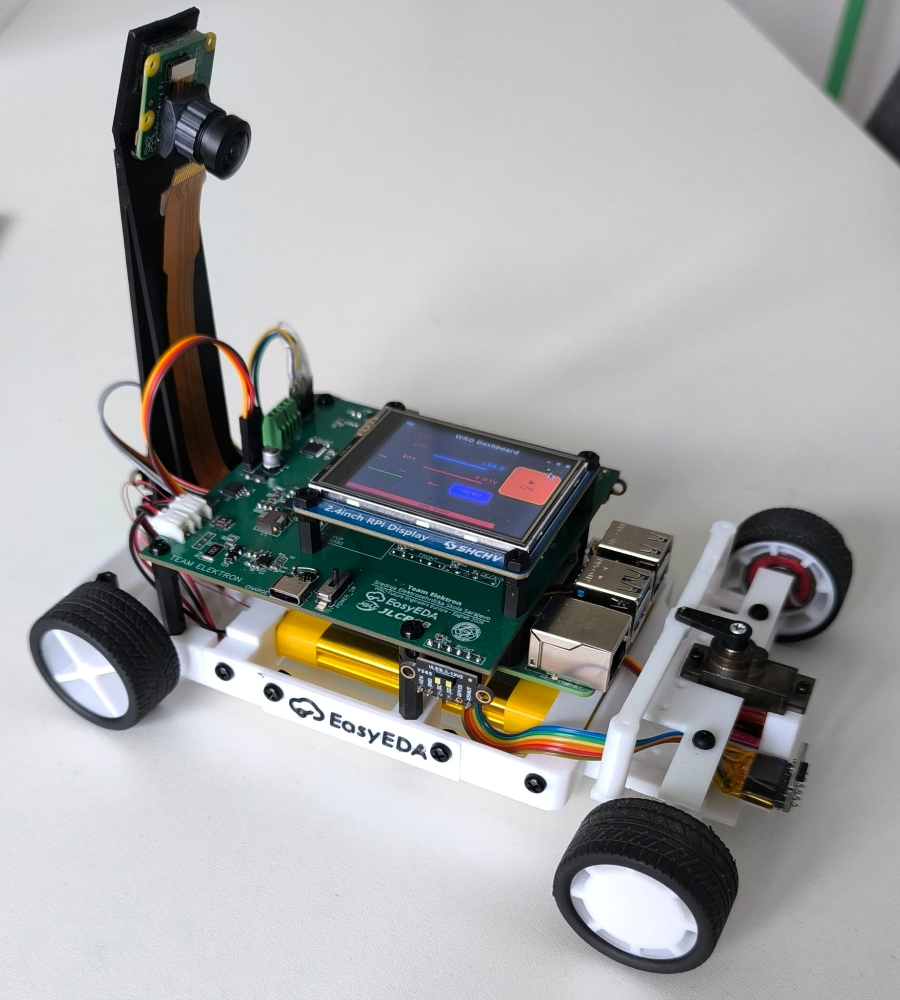</td>
    <td>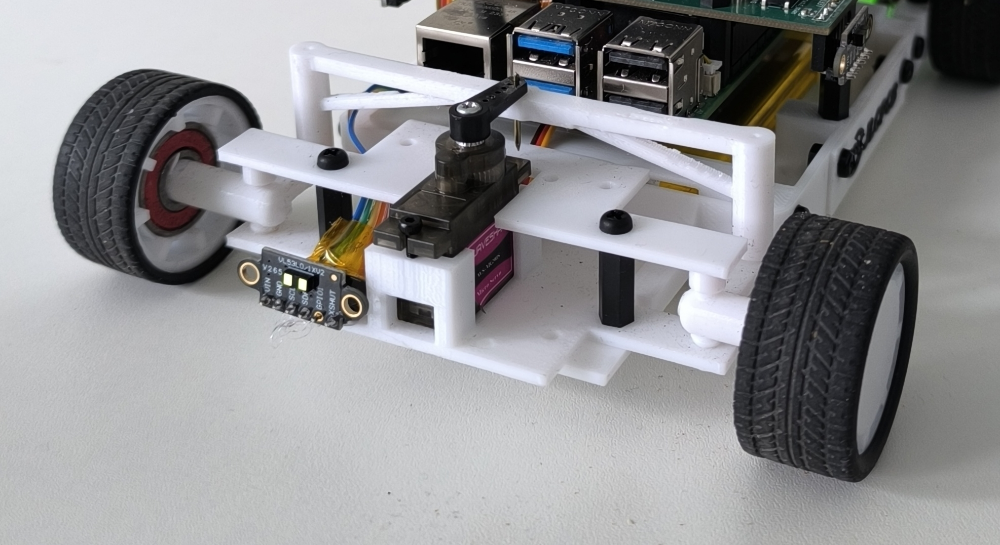</td>
  </tr>
  <tr>
    <td>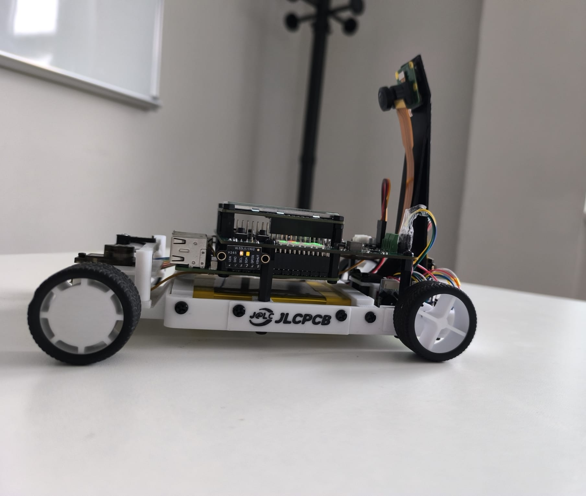</td>
    <td>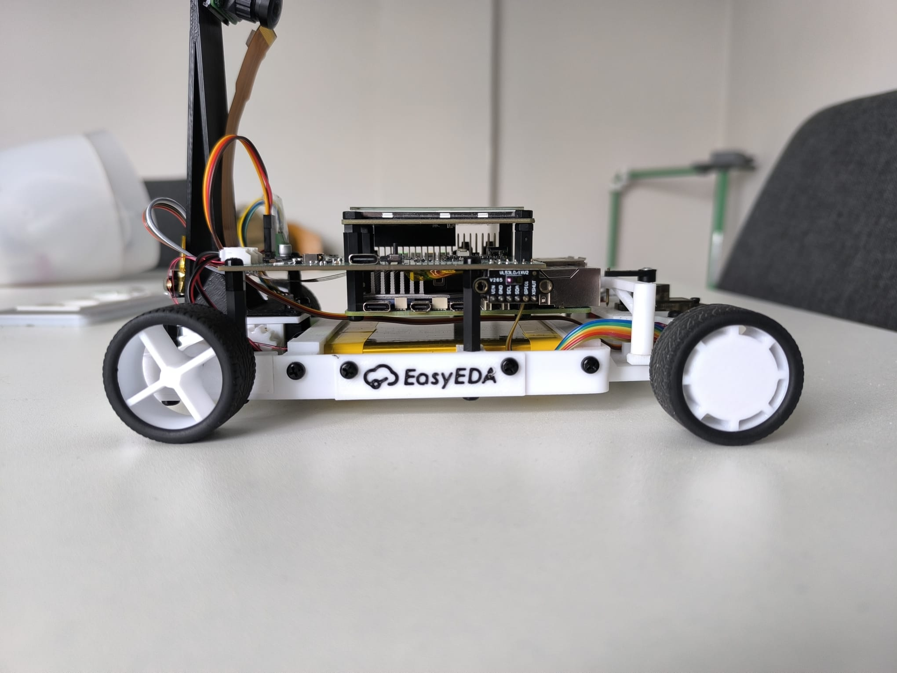</td>
  </tr>
</table>

## Contents

- [Robot at a glance](#robot-at-a-glance)
- [Development story](#development-story)
- [Mechanical design](#mechanical-design)
- [Electrical and power system](#electrical-and-power-system)
- [Sensors and processing](#sensors-and-processing)
- [Software architecture](#software-architecture)
- [Open Challenge strategy](#open-challenge-strategy)
- [Obstacle Challenge strategy](#obstacle-challenge-strategy)
- [Manufacturing and assembly](#manufacturing-and-assembly)
- [Testing and engineering decisions](#testing-and-engineering-decisions)
- [Reproduction and setup](#reproduction-and-setup)
- [Bill of materials](#bill-of-materials)
- [Videos](#videos)
- [Repository structure](#repository-structure)
- [Known limitations and future improvements](#known-limitations-and-future-improvements)

## Robot at a glance

| Category | Specification |
|---|---|
| Dimensions without camera | 205 x 135 x 65 mm |
| Approximate dimensions with camera | 205 x 135 x 150 mm |
| Weight | Approximately 490 g |
| Main computer | Raspberry Pi 5, 8 GB |
| Low-level controller | Raspberry Pi Pico 2 Zero |
| Drive | Two N30 1:150 motors on one shared shaft |
| Final transfer ratio | 1.67:1 |
| Steering | MG90S metal-gear servo, approximately 50 degrees each side |
| Battery | Two 3.7 V, 5 Ah LiPo cells in series |
| Motor driver | DRV8833, limited to 1 A per channel |
| Camera | Raspberry Pi Camera Module 2, 160 degree field of view |
| Distance sensing | Four VL53L1X Time-of-Flight sensors through a TCA9548APWR multiplexer |
| Inertial sensing | IMU for turn-angle measurement |
| Interface | 2.4 inch TFT touch display |
| Communication | 115200 baud UART with CRC8-protected packets |

<table>
  <tr>
    <td>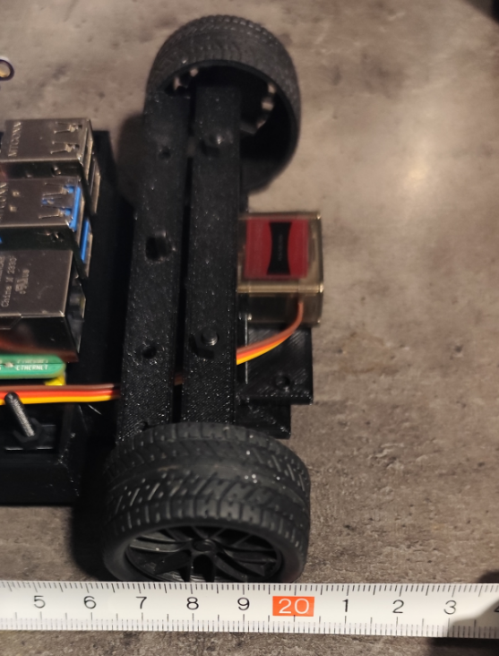</td>
    <td>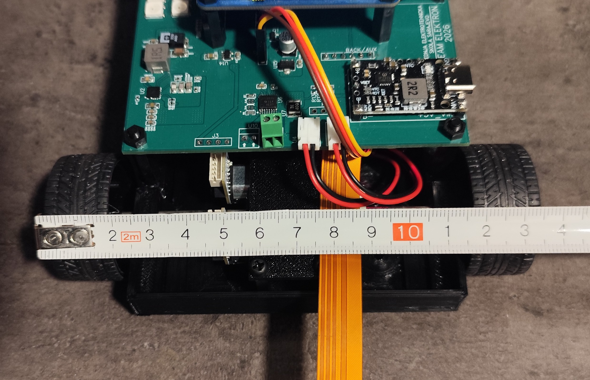</td>
    <td>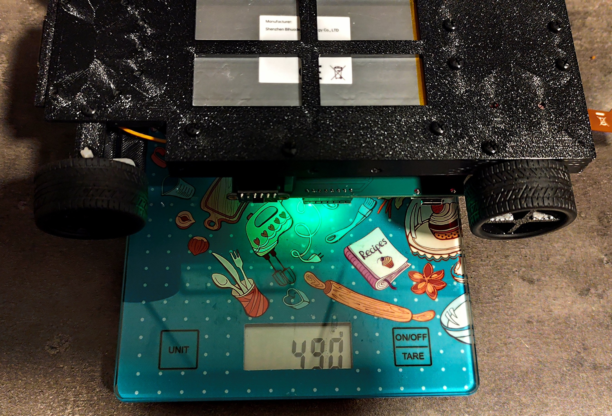</td>
  </tr>
</table>

## Development story

After the national competition in Zenica, we redesigned the drive ratio, control electronics, chassis, steering, and distance-sensing system.

| Area | Earlier design | Change | Reason |
|---|---|---|---|
| Drive | Fast ratio with weak low-speed control | Tested 3:1, 1:1, and 1.67:1 | Needed lap speed and parking torque |
| Electronics | Custom PCB with every I2C sensor on one shared bus | New custom PCB with TCA9548APWR multiplexer, improved protection, charging, balancing, switching, and connectors | Removed shared-resistance and crosstalk problems while integrating the robot as one system |
| Chassis | 150 g black PETG chassis with two reinforcement rods and difficult gearbox access | 50 g white CopyMaster3D PETG modular chassis | Reduced mass by about 100 g and made the drive system removable |
| Steering | Steering shaft with missing degrees and drift | Precision shaft, bearings, and wider wheels with the same MG90S servo | Achieved repeatable steering with a wider rotation range |
| Distance sensing | VL53L0X ToF sensors on one shared I2C line | VL53L1X sensors on separate multiplexer channels | Better field-of-view control, precision, polling rate, and bus reliability |

Each change addressed a problem observed during construction, testing, or the previous competition. The following sections document the final design and the reasoning behind it.

## Mechanical design

### Drive system

The vehicle uses two N30 motors with internal 1:150 gearboxes. Both motors are mechanically connected to one shared 110 mm long, 3 mm diameter steel shaft. They use separate DRV8833 channels to distribute electrical load, but both act on the same mechanical shaft.

The redesigned drive module uses a 1:1.67 transfer gearbox and tighter tolerances in the gearbox and motor-holder geometry. The closer fit keeps the gears aligned, reduces unwanted movement, and makes the response more consistent at low speed. The entire drive and gearbox assembly is now a removable module rather than a mechanism trapped inside the chassis.

<table>
  <tr>
    <td width="25%" valign="center">
      
    </td>
    <td width="25%" valign="center">
      
    </td>
  </tr>
</table>

We compared three motor-to-shaft ratios:

| Ratio | Result | Decision |
|---|---|---|
| 3:1 | Good speed but weak low-speed torque | Rejected because accurate parking was difficult |
| 1:1 | Strong torque but low maximum speed | Rejected because lap speed was too low |
| 1.67:1 | Balanced speed and low-speed torque | Selected for both challenges |

The wheels are 3D printed and measure 30 mm in diameter before the rubber tread is fitted. Plastic gears transfer power to the steel shaft. The motor Hall sensors provide speed feedback, and the Pico 2 runs the motor PID controller.

<table>
  <tr>
    <td>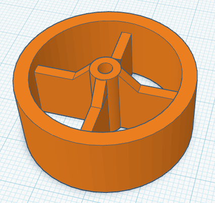</td>
    <td>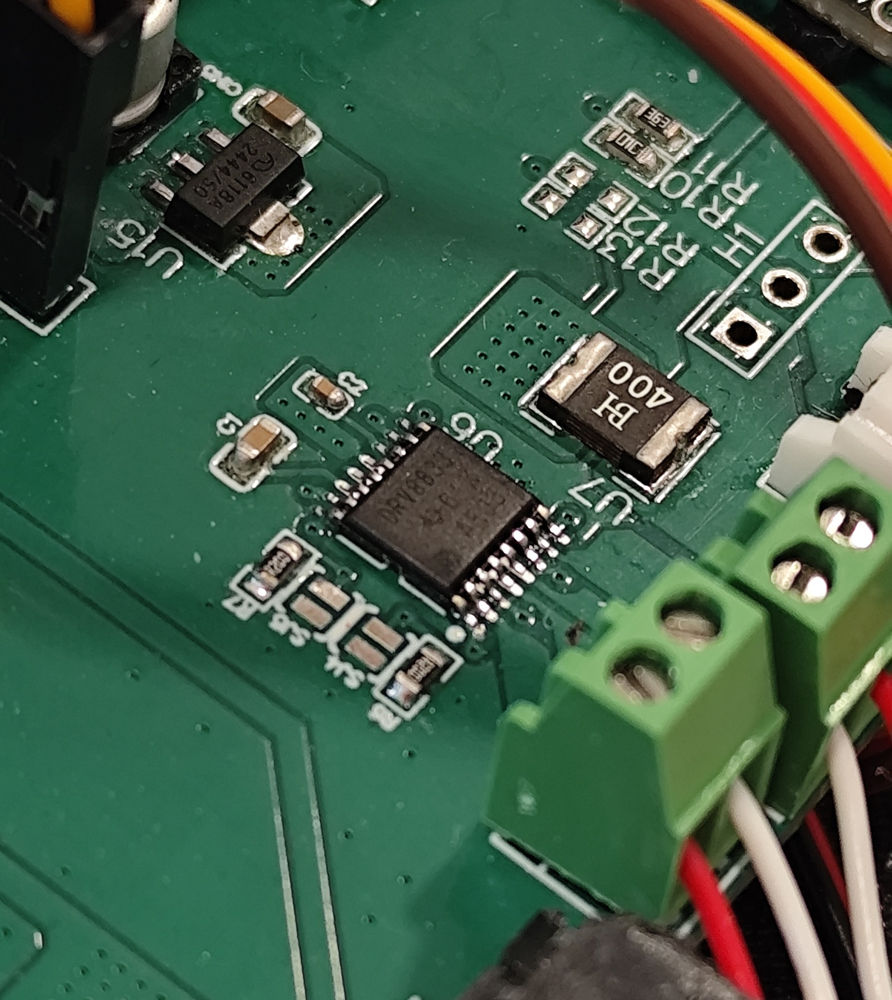</td>
    <td>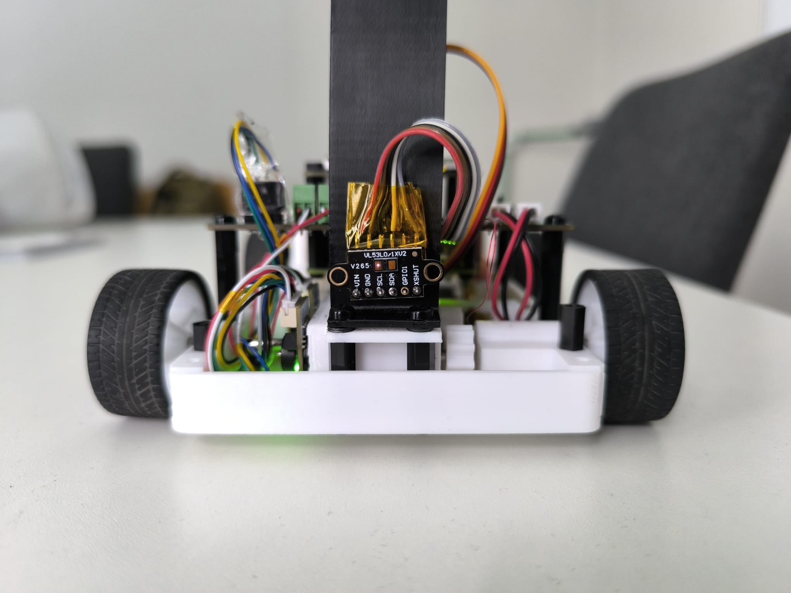</td>
  </tr>
</table>

### Steering system

An MG90S metal-gear servo controls the front steering mechanism. The servo itself remains unchanged because it provides enough torque and speed for the vehicle.

The rest of the steering system was redesigned extensively. It now uses a precise steering shaft, wheel bearings, and wider front wheels. The new geometry provides a wider usable rotation range without the missing degrees or steering drift found in the previous mechanism. The bearings reduce rolling resistance and keep the wheel movement repeatable.

The steering assembly has three printed parts:

1. Lower base and servo holder
2. Steering axle
3. Upper cover and ToF sensor holder

<table>
  <tr>
    <td></td>
  </tr>
</table>

### Chassis

The previous chassis was printed in black PETG and used two reinforcement rods. It was very stiff and sturdy, but weighed about 150 g. Its main tradeoff was serviceability because accessing the gearbox required substantial disassembly.

The new chassis is printed in white CopyMaster3D PETG and weighs approximately 50 g. The gearbox and complete drive system are separated from the main chassis and can be removed as a module. This reduces mass by about 100 g while making maintenance much easier.

A new battery hot-swap mechanism allows the battery to be removed and replaced without dismantling the robot. The chassis still uses M3 nylon screws and standoffs where possible to reduce weight.

The new camera tower is also modular and printable as two separate pieces. This makes it easier to print, replace, and adjust without remaking the main chassis.

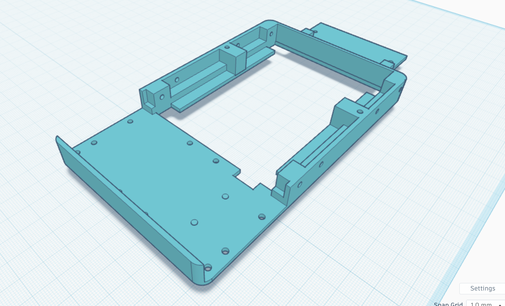

## Electrical and power system

### Battery

Two 5360105 LiPo cells, each rated at 3.7 V and 5 Ah, are connected in series. Each cell includes its own battery-management system. We selected a 2S system instead of the previous 3S system to save space and weight.

### Power distribution

| Rail | Regulator | Load |
|---|---|---|
| 5 V high-current | TPS54623RHLR buck regulator, designed for at least 5 A | Raspberry Pi 5 |
| 3.3 V | AP2112K-3.3TRG1, 1 A LDO | Pico 2 and sensors |
| 5 V servo | ME6118A50PG, 1 A LDO | MG90S servo |

The TPS54623 circuit was designed in Texas Instruments WEBENCH for 5 V output and enough current for the Raspberry Pi 5. The previous robot also used a custom PCB, but its sensors shared one I2C line and shared pull-up resistance. The new PCB retains the integrated approach while improving power protection, charging, balancing, switching, connector placement, and bus isolation.

The power design uses additional decoupling:

| Component | Quantity | Purpose |
|---|---:|---|
| 220 uF polymer tantalum capacitor | 1 | Bulk energy storage |
| 10 uF ceramic capacitor | 2 | Mid-frequency decoupling |
| 100 nF ceramic capacitor | 4 | High-frequency decoupling close to the Pi power pins |

<table>
  <tr>
    <td>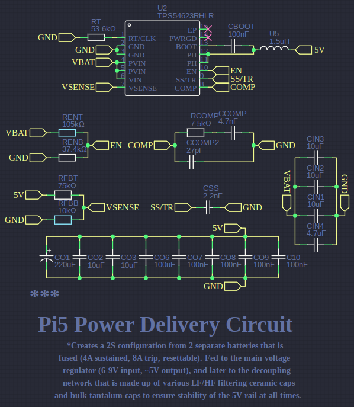</td>
    <td>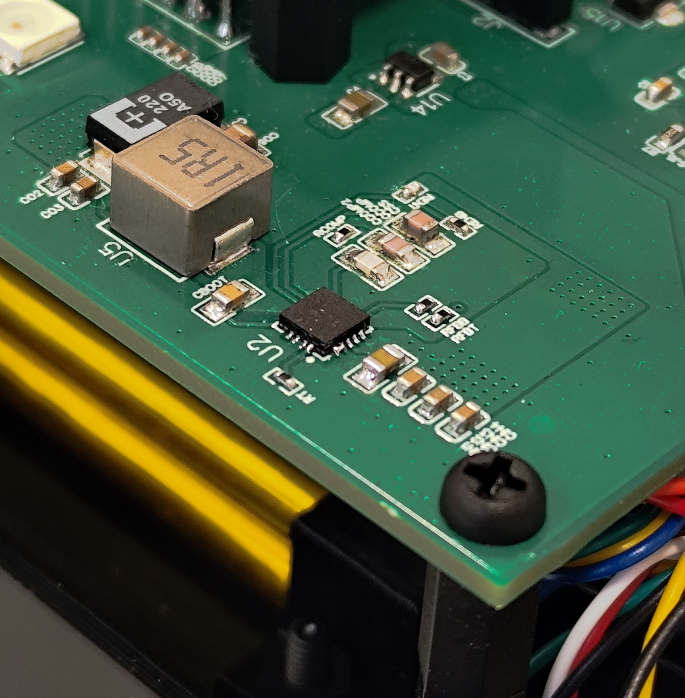</td>
  </tr>
</table>

### Charging

The new board uses a BQ25792RQMR charge-management IC with USB-C Power Delivery input up to 20 V. The charger is monitored and controlled by the Pico 2, which also reports battery and charger information to the Raspberry Pi 5.

A dedicated BQ29209DRBR battery-balancer circuit provides approximately 210 mA balancing current. This allows the system to use more of the safe capacity of each cell while keeping the two-cell pack balanced.

The previous board had no main robot power switch. The new PCB fixes this and also improves connector placement so the power, sensors, motors, and communication wiring fit the physical layout more cleanly.

### Smart charging and fuel-gauge behavior

The Pico 2 acts as the connection between the charging system and Raspberry Pi 5. It monitors the charger, battery voltage, cell state, charging current, and temperature information, then exposes the relevant data through the Pi UART, native USB debug interface, and addressable LEDs.

When Raspberry Pi UART traffic is inactive, the requested charging-current limit is 2 A. When the Pico detects an active Pi 5 UART connection, it increases the requested limit to 2.5 A to compensate for the additional current used by the Pi. The limit can change while operating rather than being fixed at startup.

The charging controller uses PID-based feedback to adjust the current limit dynamically from charge-circuit and battery-temperature data. Charge current is reduced as necessary to keep the BQ25792RQMR charger die at or below the configured 80 degree Celsius target. Hardware protection remains responsible for final electrical safety.

Battery level and charging state are visible through:

- Telemetry sent to the Raspberry Pi 5
- Human-readable debug data through the Pico USB connection
- Four addressable battery-level LEDs
- A separate charge and discharge indicator

This interaction between charging, battery measurement, communication, status display, and motion control is intentional. The electronics are designed as one closely integrated system rather than a group of unrelated modules.

The circuit schematic, Gerber files, and electronic BOM are available in [`schematics/`](schematics/).

## Sensors and processing

### Camera

The Raspberry Pi Camera Module 2 provides a 160 degree field of view. The Raspberry Pi 5 captures the image and processes it with OpenCV. The current vision code uses LAB color space to reduce false detections when lighting changes.

### Time-of-Flight sensors

The previous robot used VL53L0X Time-of-Flight sensors. They were not reliable enough for our tasks because their field of view, precision, and polling performance limited consistent navigation.

The new robot uses VL53L1X sensors. They provide better field-of-view control, improved precision, and a higher useful polling rate. The sensors measure wall and obstacle distances for centering, clearance checks, reversing, and parking.

On the previous PCB, all sensors were wired to one I2C line with shared pull-up resistance. This produced significant crosstalk and reliability problems. The new PCB connects the devices through a TCA9548APWR I2C multiplexer. Each sensor has an isolated channel, so devices with the same address are never exposed to the upstream bus at the same time.

The side sensors are used for wall centering. The front sensor checks forward clearance, while the rear sensor supports reversing and obstacle maneuvers close to corners.

The multiplexer is controlled by the Pico 2 firmware described in the Pi 5 to Pico communication bridge. Before each transfer, the firmware selects the required channel, communicates with one device, and deselects the branch. This architecture removes the shared-bus resistance problem and makes individual sensor faults easier to detect and recover from.

### IMU

The LSM6DSV16XTR IMU provides relative yaw for turns. It is very precise and does not drift at all. No more resetting yaw in between turns like with the MPU6050. Good riddance.

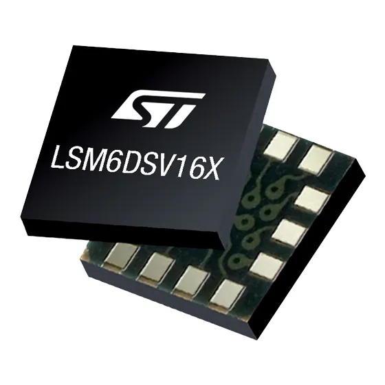

### Encoder

Hall-effect feedback measures drive speed. The Pico 2 processes the encoder data and adjusts the DRV8833 output through a PID controller.

## Software architecture

The robot uses two controllers with different responsibilities.

### Raspberry Pi 5 responsibilities

- Camera capture and OpenCV processing
- Track and color detection
- Open and Obstacle Challenge strategy
- Mapping and parking decisions
- TFT touch interface
- High-level motion commands

### Pico 2 responsibilities

- Motor direction and speed
- Motor PID control
- Steering output
- ToF and IMU readings
- Encoder feedback
- Battery telemetry
- Status LEDs
- UART communication
- TCA9548APWR channel selection and I2C isolation
- BQ25792RQMR charging control and telemetry
- Reporting the balanced two-cell battery state to the rest of the robot
- Battery fuel-gauge reporting

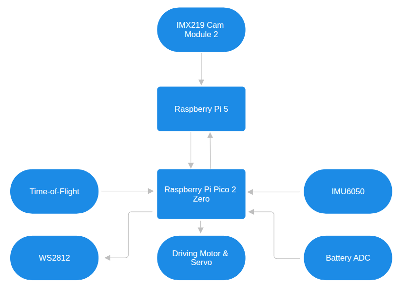

### UART protocol

Every packet contains a start byte, message type, payload length, payload, and CRC8 checksum:

```text
[0xAA] [TYPE] [LENGTH] [PAYLOAD...] [CRC8]
```

Raspberry Pi to Pico command:

```text
[0xAA] [0x01] [0x04] [direction] [speed] [servo] [led_mode] [CRC8]
```

| Field | Values |
|---|---|
| `direction` | 0 stop, 1 forward, 2 backward |
| `speed` | 0 to 255 |
| `servo` | 0 to 180 |
| `led_mode` | 0 idle, 1 driving, 2 obstacle, 3 low battery |

Pico to Raspberry Pi telemetry:

```text
[0xAA] [0x02] [0x0E]
[tof0_H] [tof0_L] [tof1_H] [tof1_L]
[tof2_H] [tof2_L] [tof3_H] [tof3_L]
[batt_H] [batt_L] [yaw_H] [yaw_L]
[enc_H] [enc_L] [CRC8]
```

Telemetry contains four ToF values in millimeters, battery voltage, yaw in tenths of a degree, and signed encoder ticks.

### User interface

The 2.4 inch TFT touch display shows telemetry and allows manual control during debugging. The competition interface is simplified to challenge selection and one start control. We also have backup start buttons for each challenge should something happen to the screen. 

### Addressable status LEDs

The addressable LEDs provide a direct view of the robot state without requiring a laptop or opening the TFT diagnostic page.

| Color or group | Meaning |
|---|---|
| Four battery LEDs | Battery level |
| Ready indicator | Controller and required systems are initialized |
| Movement indicator | Movement state received from the Raspberry Pi 5 |
| Red | Power fault |
| Orange | Sensor communication lost after successful initialization |
| Pink | IMU initialization failure |
| Purple | ToF initialization failure |
| Charge indicator | Charging state |
| Discharge indicator | Battery is supplying the robot |

The same underlying state is available through the Raspberry Pi UART and the native USB debug UART. This means the status display, charger behavior, battery reporting, and movement state all come from one shared system state rather than separate indicators with unrelated logic.

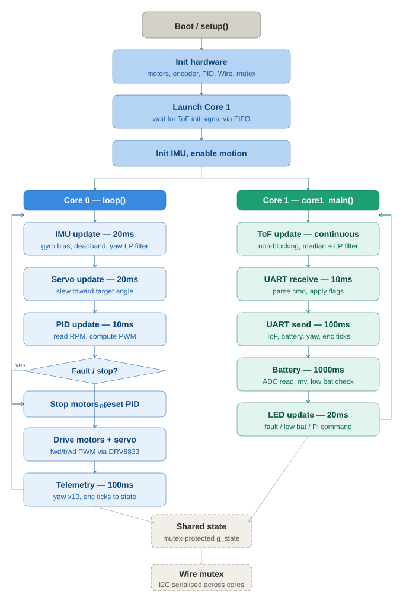

## Open Challenge strategy

The camera detects the color-coded track markings. When a corner is confirmed, the robot uses the IMU to complete an approximately 90 degree turn and then uses the side ToF sensors to center itself between the walls.

1. Capture a camera frame.
2. Convert it to LAB color space.
3. Detect the relevant colored marking.
4. Continue straight while correcting wall-centering error.
5. Begin a turn when a corner is confirmed.
6. Use IMU yaw to complete the turn.
7. Recenter and resume detection.
8. Count corners and completed laps.
9. After three laps, return to the starting section and stop.

Vision detects track events, the IMU measures rotation, and the ToF sensors provide local positioning. Each sensor therefore has a specific role in the navigation process.

The current robot completes the Open Challenge in approximately 30 to 45 seconds in either driving direction. The variation depends on track setup, steering corrections, and how quickly each corner is detected and completed.

## Obstacle Challenge strategy

During the first lap, the robot maps the walls, colored obstacles, and parking area using the camera and ToF sensors. Obstacle color determines the required passing side.

When an obstacle is detected, the program evaluates four maneuver simulations before deciding whether it can pass directly or must reverse and adjust. For obstacles near a corner, the front and rear ToF sensors check whether enough space is available.

The parking area is mapped as the robot leaves the start. This stored position simplifies the final parking maneuver.

<table>
  <tr>
    <td>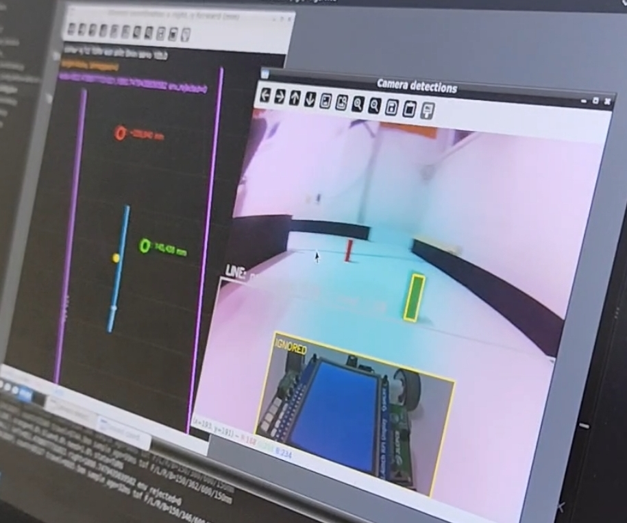</td>
    <td>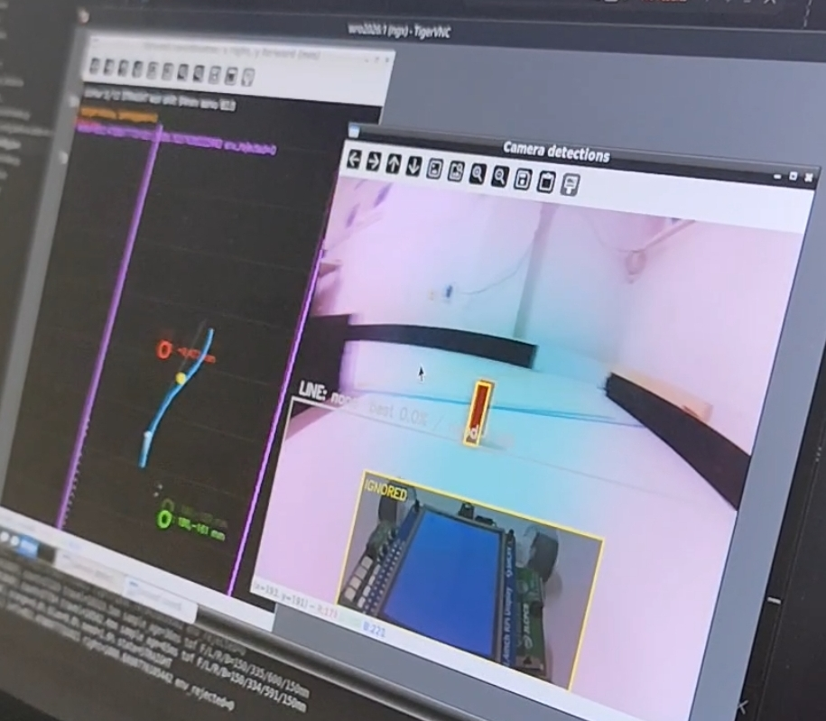</td>
  </tr>
</table>

## Manufacturing and assembly

### PCB

The custom PCB was designed in EasyEDA and manufactured with sponsorship from JLCPCB. It has four copper layers and is 1.6 mm thick. The bottom layer carries the main power rails and provides a ground plane. The internal layers carry I2C, UART, and other signals. The top layer acts mainly as another ground plane, with additional power and signal routing. Ground-stitching vias connect the ground regions.

<table>
  <tr>
    <td>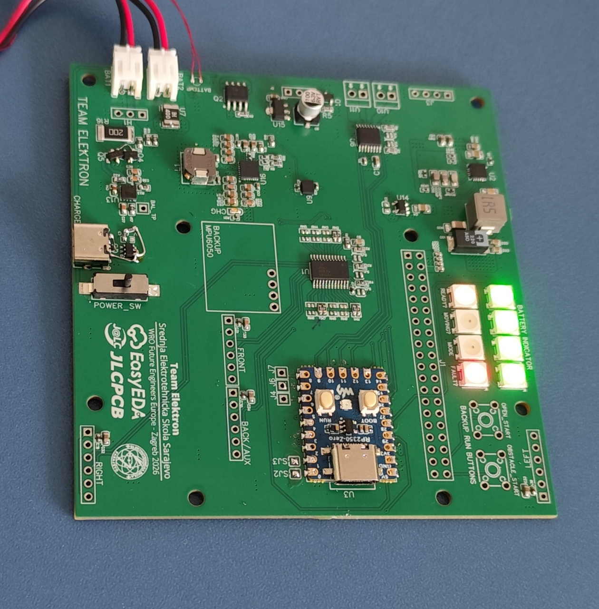</td>
    <td>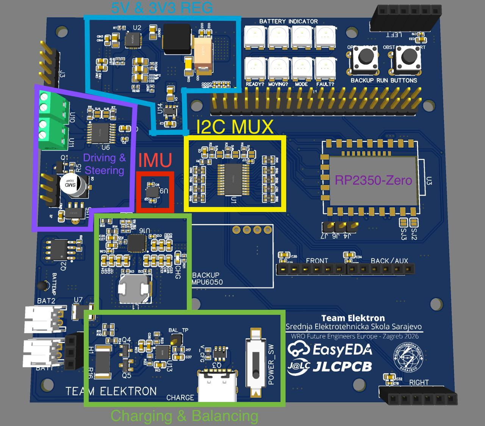</td>
  </tr>
</table>

The board was assembled by hand using our BGA rework station. The TPS54623 regulator in its VQFN-14 package was the most difficult part. After reflow, we removed excess solder around the package and inspected the joints with additional flux. The PCB worked during its first complete power-up test.

[PCB assembly video](https://cloud.sphereconsoles.com/index.php/s/2eqJmXQ9cgKXqKD)

### Printed parts

The new parts were printed in white CopyMaster3D PETG on an Ender 3 V3 KE. The main chassis weighs approximately 50 g, compared with about 150 g for the previous black PETG design with two reinforcement rods.

The gearbox and drive assembly are fully removable, the battery uses a hot-swap mechanism, and the camera tower is printed as two separate pieces. This modular construction makes maintenance much easier than on the previous chassis.

<table>
  <tr>
    <td>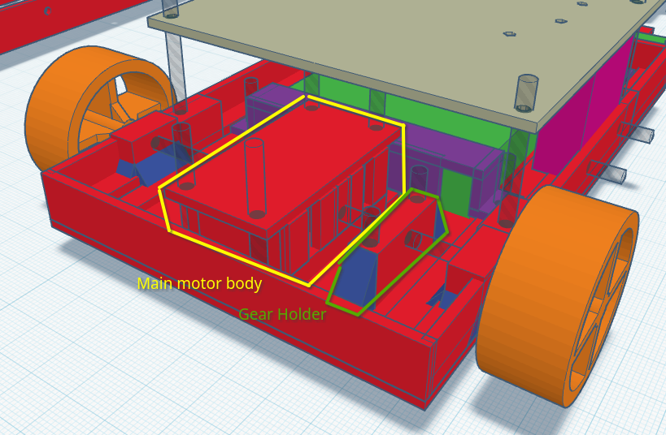</td>
    <td>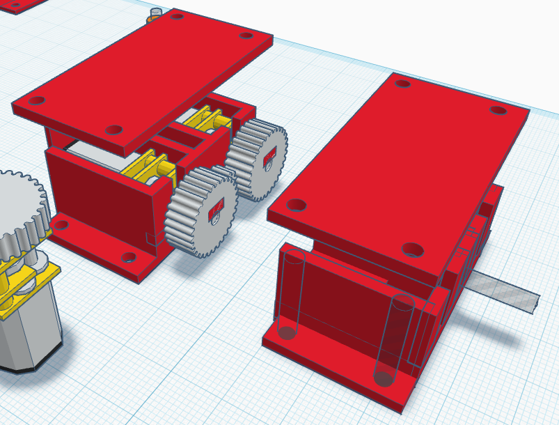</td>
  </tr>
</table>

## Testing and engineering decisions

### Gear ratio

The 3:1 system was fast but made parking difficult. The 1:1 system had strong torque but was too slow. The 1.67:1 ratio was selected as the best compromise.

### Chassis

The previous dual-reinforcement-rod chassis was very stiff but weighed about 150 g and made gearbox work difficult. The new white PETG chassis weighs approximately 50 g and uses a separate, removable drive module. The battery hot-swap mechanism also allows faster replacement without dismantling the robot.

### Steering

The steering system now uses a precise shaft, wheel bearings, and wider wheels. It keeps the MG90S servo but no longer loses steering degrees or drifts from the intended position. The revised geometry also provides a wider rotation field.

### Power

The previous robot already used a custom PCB. Its main issue was the shared I2C sensor bus, not separate power modules. The new design adds improved protection, a BQ25792RQMR charger, BQ29209DRBR 210 mA cell balancing, a main power switch, improved connector placement, isolated sensor channels, 20 V USB-C PD input, and software-controlled charge-current regulation.

### Whole-system integration

The Pico 2 connects the motion system, sensors, Raspberry Pi, charger, battery measurements, USB diagnostics, and LEDs. An active Pi UART link changes the charging-current policy from 2 A to 2.5 A, while charger and battery temperature feedback can reduce the current dynamically. The same system state drives UART telemetry, USB diagnostics, battery indication, ready status, movement status, charge state, and fault colors.

This close interaction is a major engineering improvement over the previous robot. A power, sensor, IMU, charging, or communication issue is visible throughout the system instead of remaining isolated inside one subsystem.

## Reproduction and setup

### Mechanical assembly

1. Print the white CopyMaster3D PETG (or similar) chassis, removable drive housing, wheels, steering components, sensor mounts, hot-swap battery parts, and two-piece camera tower.
2. Install the N30 motors in the two-part housing.
3. Fit and align the plastic gears and shared steel shaft.
4. Install the rear wheels and check for binding.
5. Assemble the front steering and center the servo before attaching the axle.
6. Install the battery, PCB, Raspberry Pi, camera, sensors, and display.
7. Secure wiring away from the gears, linkage, and wheels.

### Electrical setup

1. Verify battery polarity and all power rails before connecting the battery to the PCB.
2. Confirm 5 V for the Pi, 3.3 V for the controller and sensors, and 5 V for the servo.
3. Check motor, encoder, UART, camera, and sensor wiring against the schematic.
4. Raise the driven wheels before the first motor test.

### Calibration

1. Keep the robot stationary while establishing the IMU reference. (This is more of a precaution with the new IMU sensor)
2. Check color calibration values in mask calibration script.
3. Verify every distance sensor and its physical direction.
4. Center the steering and check both mechanical limits.
5. Confirm forward and reverse motor direction.
6. Verify encoder feedback and PID response at low speed.
7. Tune LAB thresholds under representative field lighting.

## Bill of materials

- [Raspberry Pi Pico 2 Zero by Waveshare](https://www.waveshare.com/rp2350-zero.htm)
- [Raspberry Pi 5, 8 GB](https://sync.ba/product/raspberry-pi-5/)
- VL53L1X Time-of-Flight sensors
- TCA9548APWR I2C multiplexer
- IMU module
- [MG90S metal-gear servo](https://www.waveshare.com/mg90s-servo.htm)
- Two N30 1:150 motors with Hall sensors
- Two 5360105 3.7 V, 5 Ah LiPo cells
- BQ25792RQMR charge-management IC
- BQ29209DRBR battery balancer, approximately 210 mA balancing current
- USB-C Power Delivery input for up to 20 V
- DRV8833 motor driver
- TPS54623 buck regulator
- AP2112K 3.3 V regulator
- ME6118A 5 V servo regulator
- Raspberry Pi Camera Module 2 with wide-angle lens
- 2.4 inch TFT touch display
- Addressable LEDs
- Custom four-layer PCB
- 3D-printed PETG structure

The complete electronic BOM is available in [`schematics/BOM_WRO-FE-2026-EUROPE_2026-09-27.csv`](schematics/BOM_WRO-FE-2026-EUROPE_2026-09-27.csv).

## Videos

Challenge demonstration links are listed in [`videos/video.md`](videos/video.md):

- Open Challenge with large walls
- Open Challenge with small walls
- Obstacle Challenge

## Repository structure

| Directory | Contents |
|---|---|
| [`team-photos/`](team-photos/) | Team photographs |
| [`robot-photos/`](robot-photos/) | Robot views, assembly photographs, and diagrams |
| [`videos/`](videos/) | Challenge demonstration links |
| [`schematics/`](schematics/) | Schematic, Gerber files, and PCB BOM |
| [`code/`](code/) | Competition software and controller firmware |
| [`3d-models/`](3d-models/) | Printable mechanical components |

## Known limitations and future improvements

- Lighting changes can affect color detection, so LAB thresholds must be checked at the venue.
- Very high current draw, a new robot needs to have a more lightweight method of image processing for future competitions.
